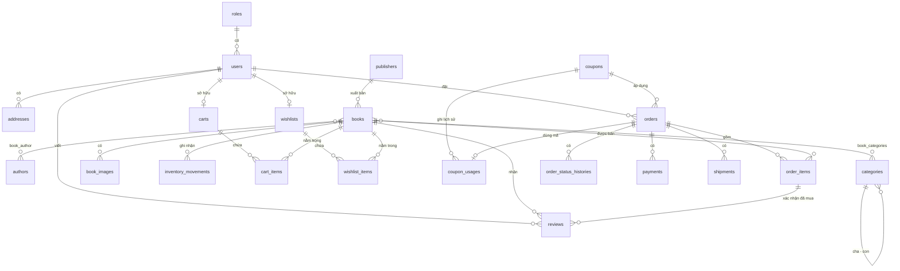

# Mô tả chi tiết CSDL website bán sách (MySQL)

> File đi kèm: `schema.sql` (MySQL 8.0+, InnoDB, `utf8mb4_unicode_ci`).
> Database: `bookstore` — 23 bảng, chia thành 8 nhóm.

---

## Mục lục

1. [Kiến thức nền](#1-kiến-thức-nền)
2. [Tổng quan kiến trúc dữ liệu](#2-tổng-quan-kiến-trúc-dữ-liệu)
3. [Nhóm người dùng](#3-nhóm-người-dùng)
4. [Nhóm sản phẩm](#4-nhóm-sản-phẩm)
5. [Nhóm giỏ hàng](#5-nhóm-giỏ-hàng)
6. [Nhóm giảm giá](#6-nhóm-giảm-giá)
7. [Nhóm đơn hàng](#7-nhóm-đơn-hàng)
8. [Nhóm thanh toán và vận chuyển](#8-nhóm-thanh-toán-và-vận-chuyển)
9. [Nhóm tương tác](#9-nhóm-tương-tác)
10. [Nhóm quản lý kho](#10-nhóm-quản-lý-kho)
11. [Tổng hợp quan hệ](#11-tổng-hợp-quan-hệ)
12. [Luồng dữ liệu: đặt hàng COD](#12-luồng-dữ-liệu-đặt-hàng-cod)
13. [Các quyết định thiết kế](#13-các-quyết-định-thiết-kế)
14. [Quy tắc do ứng dụng đảm nhiệm](#14-quy-tắc-do-ứng-dụng-đảm-nhiệm)
15. [Gợi ý index và truy vấn mẫu](#15-gợi-ý-index-và-truy-vấn-mẫu)

---

## 1. Kiến thức nền

| Khái niệm              | Ý nghĩa                                                                                                  |
| ---------------------- | -------------------------------------------------------------------------------------------------------- |
| **PRIMARY KEY (PK)**   | Cột định danh duy nhất mỗi dòng. Trong schema này luôn là `id`, kiểu `BIGINT UNSIGNED AUTO_INCREMENT`.   |
| **FOREIGN KEY (FK)**   | Cột chứa `id` của bảng khác. DB từ chối giá trị không tồn tại ở bảng được trỏ tới.                       |
| **UNIQUE**             | Cấm hai dòng trùng giá trị ở cột (hoặc bộ cột) đó. MySQL cho phép nhiều giá trị `NULL` trong cột UNIQUE. |
| **INDEX**              | Chỉ mục giúp tra cứu nhanh; đổi lại ghi dữ liệu chậm hơn một chút.                                       |
| **CHECK**              | Điều kiện dữ liệu phải thỏa (chỉ được thi hành từ MySQL 8.0.16).                                         |
| **NULL / NOT NULL**    | Cho phép hay bắt buộc có giá trị.                                                                        |
| **ON DELETE CASCADE**  | Xóa dòng cha thì xóa luôn dòng con.                                                                      |
| **ON DELETE SET NULL** | Xóa dòng cha thì cột FK của dòng con thành `NULL`, dòng con vẫn tồn tại.                                 |
| **1-1**                | Một dòng bảng A ứng với đúng một dòng bảng B (FK + UNIQUE).                                              |
| **1-N**                | Một dòng bảng A ứng với nhiều dòng bảng B; FK nằm ở bảng B.                                              |
| **N-N**                | Cần bảng trung gian, mỗi dòng là một cặp (A, B).                                                         |
| **Soft delete**        | Không xóa thật, chỉ đánh dấu `deleted_at`. Laravel hỗ trợ sẵn qua `SoftDeletes`.                         |
| **Snapshot**           | Sao chép dữ liệu tại một thời điểm để về sau không bị thay đổi theo bảng gốc.                            |
| **Denormalize**        | Lưu sẵn giá trị tính được từ bảng khác để truy vấn nhanh.                                                |

### Kiểu dữ liệu sử dụng

| Kiểu                     | Dùng cho                                                  |
| ------------------------ | --------------------------------------------------------- |
| `BIGINT UNSIGNED`        | Khóa chính, khóa ngoại (khớp `$table->id()` của Laravel). |
| `VARCHAR(n)`             | Chuỗi ngắn có giới hạn độ dài.                            |
| `TEXT`                   | Văn bản dài (mô tả, bình luận).                           |
| `DECIMAL(12,2)`          | Tiền. Chính xác tuyệt đối, không dùng `FLOAT` vì sai số.  |
| `INT UNSIGNED`           | Số lượng không âm.                                        |
| `TINYINT(1)`             | Giá trị boolean (0 hoặc 1).                               |
| `ENUM(...)`              | Chỉ nhận một trong các giá trị liệt kê.                   |
| `TIMESTAMP` / `DATETIME` | Thời điểm.                                                |

### Cột chung

Hầu hết bảng có hai cột: `created_at` (thời điểm tạo) và `updated_at` (tự cập nhật khi sửa). Các bảng "chỉ thêm" (log, lịch sử) chỉ có `created_at`. Hai cột này sẽ **không được lặp lại** ở từng bảng bên dưới.

---

## 2. Tổng quan kiến trúc dữ liệu

### Thứ tự tạo bảng

Bảng cha phải tạo trước bảng con có FK trỏ tới nó:

```
roles → users → addresses
publishers, authors, categories → books → book_author, book_categories, book_images
carts → cart_items
coupons → orders → order_items → order_status_histories, coupon_usages
payments, shipments, reviews, wishlists, wishlist_items, inventory_movements
```

### Sơ đồ ERD (Mermaid)



### Phân nhóm

| Nhóm                   | Bảng                                                                                            |
| ---------------------- | ----------------------------------------------------------------------------------------------- |
| Người dùng             | `roles`, `users`, `addresses`                                                                   |
| Sản phẩm               | `publishers`, `authors`, `categories`, `books`, `book_author`, `book_categories`, `book_images` |
| Giỏ hàng               | `carts`, `cart_items`                                                                           |
| Giảm giá               | `coupons`, `coupon_usages`                                                                      |
| Đơn hàng               | `orders`, `order_items`, `order_status_histories`                                               |
| Thanh toán, vận chuyển | `payments`, `shipments`                                                                         |
| Tương tác              | `reviews`, `wishlists`, `wishlist_items`                                                        |
| Kho                    | `inventory_movements`                                                                           |

---

## 3. Nhóm người dùng

### 3.1. `roles` — vai trò

**Mục đích:** danh mục vai trò (`admin`, `customer`). Tách bảng riêng để thêm vai trò mới chỉ cần thêm một dòng, không sửa cấu trúc `users`.

| Cột           | Kiểu            | Null  | Ràng buộc          | Ý nghĩa     |
| ------------- | --------------- | ----- | ------------------ | ----------- |
| `id`          | BIGINT UNSIGNED | Không | PK, AUTO_INCREMENT | Định danh   |
| `name`        | VARCHAR(50)     | Không | UNIQUE             | Tên vai trò |
| `description` | VARCHAR(255)    | Có    |                    | Mô tả       |

**Quan hệ:** `roles` 1-N `users`.

### 3.2. `users` — tài khoản

**Mục đích:** thông tin đăng nhập và hồ sơ cơ bản.

| Cột                 | Kiểu                    | Null  | Ràng buộc         | Ý nghĩa                                                           |
| ------------------- | ----------------------- | ----- | ----------------- | ----------------------------------------------------------------- |
| `id`                | BIGINT UNSIGNED         | Không | PK                | Định danh                                                         |
| `role_id`           | BIGINT UNSIGNED         | Không | FK → `roles.id`   | Vai trò                                                           |
| `full_name`         | VARCHAR(100)            | Không |                   | Họ tên hiển thị                                                   |
| `email`             | VARCHAR(150)            | Không | UNIQUE            | Dùng để đăng nhập                                                 |
| `password`          | VARCHAR(255)            | Không |                   | **Chuỗi hash** (bcrypt/argon2), tuyệt đối không lưu mật khẩu thật |
| `phone`             | VARCHAR(20)             | Có    |                   | Số điện thoại                                                     |
| `avatar_url`        | VARCHAR(500)            | Có    |                   | Đường dẫn ảnh đại diện                                            |
| `status`            | ENUM('active','locked') | Không | Mặc định `active` | Cho phép khóa tài khoản mà không xóa                              |
| `email_verified_at` | TIMESTAMP               | Có    |                   | `NULL` = chưa xác minh email                                      |
| `remember_token`    | VARCHAR(100)            | Có    |                   | Laravel dùng cho "ghi nhớ đăng nhập"                              |
| `deleted_at`        | TIMESTAMP               | Có    |                   | Soft delete                                                       |

**Quan hệ:**

- `roles` 1-N `users` (FK `role_id`, không có ON DELETE nên không thể xóa vai trò đang có người dùng).
- `users` 1-N `addresses`, `orders`, `reviews`.
- `users` 1-1 `carts`, `wishlists`.

### 3.3. `addresses` — sổ địa chỉ

**Mục đích:** mỗi user lưu nhiều địa chỉ nhận hàng.

| Cột              | Kiểu            | Null  | Ràng buộc                                | Ý nghĩa                                |
| ---------------- | --------------- | ----- | ---------------------------------------- | -------------------------------------- |
| `id`             | BIGINT UNSIGNED | Không | PK                                       | Định danh                              |
| `user_id`        | BIGINT UNSIGNED | Không | FK → `users.id` ON DELETE CASCADE, INDEX | Chủ địa chỉ                            |
| `recipient_name` | VARCHAR(100)    | Không |                                          | Người nhận (có thể khác chủ tài khoản) |
| `phone`          | VARCHAR(20)     | Không |                                          | SĐT người nhận                         |
| `province`       | VARCHAR(100)    | Không |                                          | Tỉnh/thành                             |
| `district`       | VARCHAR(100)    | Không |                                          | Quận/huyện                             |
| `ward`           | VARCHAR(100)    | Không |                                          | Phường/xã                              |
| `street_address` | VARCHAR(255)    | Không |                                          | Số nhà, tên đường                      |
| `is_default`     | TINYINT(1)      | Không | Mặc định 0                               | Địa chỉ mặc định                       |

**Quan hệ:** `users` 1-N `addresses`.
**Lưu ý:** DB không ép "mỗi user chỉ một địa chỉ mặc định"; ứng dụng phải đảm bảo.

---

## 4. Nhóm sản phẩm

### 4.1. `publishers` — nhà xuất bản

| Cột       | Kiểu            | Null  | Ràng buộc | Ý nghĩa   |
| --------- | --------------- | ----- | --------- | --------- |
| `id`      | BIGINT UNSIGNED | Không | PK        | Định danh |
| `name`    | VARCHAR(150)    | Không | UNIQUE    | Tên NXB   |
| `website` | VARCHAR(255)    | Có    |           | Website   |

**Quan hệ:** `publishers` 1-N `books`.

### 4.2. `authors` — tác giả

| Cột         | Kiểu            | Null  | Ràng buộc            | Ý nghĩa                                                           |
| ----------- | --------------- | ----- | -------------------- | ----------------------------------------------------------------- |
| `id`        | BIGINT UNSIGNED | Không | PK                   | Định danh                                                         |
| `name`      | VARCHAR(150)    | Không | INDEX (không UNIQUE) | Tên tác giả. Không UNIQUE vì hai người khác nhau có thể trùng tên |
| `biography` | TEXT            | Có    |                      | Tiểu sử                                                           |

**Quan hệ:** `authors` N-N `books` qua `book_author`.

### 4.3. `categories` — danh mục

| Cột           | Kiểu            | Null  | Ràng buộc                               | Ý nghĩa                             |
| ------------- | --------------- | ----- | --------------------------------------- | ----------------------------------- |
| `id`          | BIGINT UNSIGNED | Không | PK                                      | Định danh                           |
| `parent_id`   | BIGINT UNSIGNED | Có    | FK → `categories.id` ON DELETE SET NULL | Danh mục cha; `NULL` = danh mục gốc |
| `name`        | VARCHAR(100)    | Không |                                         | Tên hiển thị                        |
| `slug`        | VARCHAR(120)    | Không | UNIQUE                                  | Dùng trong URL, ví dụ `van-hoc`     |
| `description` | VARCHAR(500)    | Có    |                                         | Mô tả                               |

**Quan hệ:** tự tham chiếu (cha - con), cho phép phân cấp: _Văn học → Tiểu thuyết_. Và `categories` N-N `books` qua `book_categories`.

### 4.3. `books` — sách (bảng trung tâm của sản phẩm)

| Cột                | Kiểu                            | Null  | Ràng buộc                                      | Ý nghĩa                                                |
| ------------------ | ------------------------------- | ----- | ---------------------------------------------- | ------------------------------------------------------ |
| `id`               | BIGINT UNSIGNED                 | Không | PK                                             | Định danh                                              |
| `publisher_id`     | BIGINT UNSIGNED                 | Có    | FK → `publishers.id` ON DELETE SET NULL, INDEX | Nhà xuất bản                                           |
| `title`            | VARCHAR(255)                    | Không | FULLTEXT                                       | Tên sách                                               |
| `slug`             | VARCHAR(280)                    | Không | UNIQUE                                         | Đường dẫn thân thiện                                   |
| `isbn`             | VARCHAR(20)                     | Có    | UNIQUE                                         | Mã sách quốc tế                                        |
| `description`      | TEXT                            | Có    |                                                | Mô tả                                                  |
| `price`            | DECIMAL(12,2)                   | Không | CHECK `>= 0`                                   | Giá niêm yết                                           |
| `sale_price`       | DECIMAL(12,2)                   | Có    | CHECK `NULL` hoặc `0 <= sale_price <= price`   | Giá khuyến mãi; `NULL` = không giảm                    |
| `stock_quantity`   | INT UNSIGNED                    | Không | Mặc định 0                                     | Tồn kho hiện tại                                       |
| `page_count`       | SMALLINT UNSIGNED               | Có    |                                                | Số trang                                               |
| `language`         | VARCHAR(30)                     | Có    | Mặc định `Tiếng Việt`                          | Ngôn ngữ                                               |
| `publication_year` | SMALLINT UNSIGNED               | Có    |                                                | Năm xuất bản                                           |
| `cover_type`       | ENUM('paperback','hardcover')   | Có    |                                                | Bìa mềm / bìa cứng                                     |
| `status`           | ENUM('draft','active','hidden') | Không | Mặc định `active`                              | Nháp / đang bán / ẩn                                   |
| `sold_count`       | INT UNSIGNED                    | Không | Mặc định 0                                     | **Denormalize**: số đã bán, dùng để sắp xếp "bán chạy" |
| `rating_avg`       | DECIMAL(3,2)                    | Không | Mặc định 0                                     | **Denormalize**: điểm trung bình từ `reviews`          |
| `rating_count`     | INT UNSIGNED                    | Không | Mặc định 0                                     | **Denormalize**: số lượt đánh giá                      |
| `deleted_at`       | TIMESTAMP                       | Có    |                                                | Soft delete (để `order_items` cũ vẫn tham chiếu được)  |

**Index:** `(status, price)` phục vụ lọc theo trạng thái và giá; `FULLTEXT(title)` phục vụ tìm kiếm.

**Quan hệ:** `publishers` 1-N `books`; `books` N-N `authors`, `categories`; `books` 1-N `book_images`, `cart_items`, `order_items`, `reviews`, `wishlist_items`, `inventory_movements`.

### 4.4. `book_author` — trung gian sách ↔ tác giả (N-N)

| Cột         | Kiểu            | Null  | Ràng buộc                                | Ý nghĩa |
| ----------- | --------------- | ----- | ---------------------------------------- | ------- |
| `book_id`   | BIGINT UNSIGNED | Không | PK kép, FK → `books.id` CASCADE          | Sách    |
| `author_id` | BIGINT UNSIGNED | Không | PK kép, FK → `authors.id` CASCADE, INDEX | Tác giả |

**PK kép `(book_id, author_id)`** vừa nhận diện dòng, vừa chặn gắn trùng một tác giả vào cùng một sách. Index phụ `author_id` phục vụ truy vấn ngược "tác giả này viết sách nào".

| book_id | author_id | Ý nghĩa                    |
| ------- | --------- | -------------------------- |
| 1       | 5         | Sách 1 có tác giả 5        |
| 1       | 6         | Sách 1 còn có tác giả 6    |
| 2       | 5         | Tác giả 5 cũng viết sách 2 |

### 4.5. `book_categories` — trung gian sách ↔ danh mục (N-N)

| Cột           | Kiểu            | Null  | Ràng buộc                                   | Ý nghĩa  |
| ------------- | --------------- | ----- | ------------------------------------------- | -------- |
| `book_id`     | BIGINT UNSIGNED | Không | PK kép, FK → `books.id` CASCADE             | Sách     |
| `category_id` | BIGINT UNSIGNED | Không | PK kép, FK → `categories.id` CASCADE, INDEX | Danh mục |

Một sách có thể thuộc nhiều danh mục (ví dụ "Clean Code" thuộc _Công nghệ thông tin_ và _Kỹ năng_).

### 4.6. `book_images` — ảnh sách

| Cột          | Kiểu              | Null  | Ràng buộc                      | Ý nghĩa                                                          |
| ------------ | ----------------- | ----- | ------------------------------ | ---------------------------------------------------------------- |
| `id`         | BIGINT UNSIGNED   | Không | PK                             | Định danh                                                        |
| `book_id`    | BIGINT UNSIGNED   | Không | FK → `books.id` CASCADE, INDEX | Sách                                                             |
| `image_url`  | VARCHAR(500)      | Không |                                | Đường dẫn ảnh (file thật nằm ở disk/cloud, DB chỉ lưu đường dẫn) |
| `is_primary` | TINYINT(1)        | Không | Mặc định 0                     | Ảnh bìa chính                                                    |
| `sort_order` | SMALLINT UNSIGNED | Không | Mặc định 0                     | Thứ tự hiển thị                                                  |

**Quan hệ:** `books` 1-N `book_images`.

---

## 5. Nhóm giỏ hàng

### 5.1. `carts` — giỏ hàng

| Cột             | Kiểu            | Null  | Ràng buộc                       | Ý nghĩa                                |
| --------------- | --------------- | ----- | ------------------------------- | -------------------------------------- |
| `id`            | BIGINT UNSIGNED | Không | PK                              | Định danh                              |
| `user_id`       | BIGINT UNSIGNED | Có    | UNIQUE, FK → `users.id` CASCADE | Chủ giỏ; `NULL` = khách chưa đăng nhập |
| `session_token` | VARCHAR(100)    | Có    | UNIQUE                          | Mã định danh giỏ của khách vãng lai    |

UNIQUE cho phép nhiều `NULL`, nên có thể tồn tại nhiều giỏ khách vãng lai cùng lúc. `UNIQUE(user_id)` đảm bảo mỗi user đúng một giỏ.

**Quan hệ:** `users` 1-1 `carts` 1-N `cart_items`.

### 5.2. `cart_items` — dòng trong giỏ

| Cột        | Kiểu            | Null  | Ràng buộc               | Ý nghĩa   |
| ---------- | --------------- | ----- | ----------------------- | --------- |
| `id`       | BIGINT UNSIGNED | Không | PK                      | Định danh |
| `cart_id`  | BIGINT UNSIGNED | Không | FK → `carts.id` CASCADE | Giỏ       |
| `book_id`  | BIGINT UNSIGNED | Không | FK → `books.id` CASCADE | Sách      |
| `quantity` | INT UNSIGNED    | Không | Mặc định 1, CHECK `> 0` | Số lượng  |

`UNIQUE (cart_id, book_id)`: mỗi sách chỉ một dòng trong giỏ; thêm lần nữa thì ứng dụng tăng `quantity`.
**Không có cột giá:** giỏ hàng luôn hiển thị giá hiện tại từ `books`.

**Quan hệ:** `carts` 1-N `cart_items` N-1 `books`.

---

## 6. Nhóm giảm giá

### 6.1. `coupons` — mã giảm giá

| Cột                   | Kiểu                    | Null  | Ràng buộc                               | Ý nghĩa                                     |
| --------------------- | ----------------------- | ----- | --------------------------------------- | ------------------------------------------- |
| `id`                  | BIGINT UNSIGNED         | Không | PK                                      | Định danh                                   |
| `code`                | VARCHAR(50)             | Không | UNIQUE                                  | Mã khách nhập                               |
| `description`         | VARCHAR(255)            | Có    |                                         | Mô tả                                       |
| `discount_type`       | ENUM('percent','fixed') | Không |                                         | Giảm theo % hoặc số tiền cố định            |
| `discount_value`      | DECIMAL(12,2)           | Không | CHECK `> 0`; nếu `percent` thì `<= 100` | `percent`: 10 = 10%. `fixed`: số tiền VND   |
| `max_discount_amount` | DECIMAL(12,2)           | Có    |                                         | Trần giảm khi dùng `percent`                |
| `min_order_amount`    | DECIMAL(12,2)           | Không | Mặc định 0                              | Đơn tối thiểu để áp mã                      |
| `usage_limit`         | INT UNSIGNED            | Có    |                                         | Tổng lượt dùng; **`NULL` = không giới hạn** |
| `starts_at`           | DATETIME                | Có    |                                         | Bắt đầu hiệu lực                            |
| `expires_at`          | DATETIME                | Có    |                                         | Hết hạn                                     |
| `is_active`           | TINYINT(1)              | Không | Mặc định 1                              | Bật/tắt thủ công                            |

**Quan hệ:** `coupons` 1-N `orders`; `coupons` 1-N `coupon_usages`.
**Tạo trước `orders`** vì `orders.coupon_id` tham chiếu bảng này.

### 6.2. `coupon_usages` — lịch sử dùng mã

| Cột               | Kiểu            | Null  | Ràng buộc                        | Ý nghĩa                                     |
| ----------------- | --------------- | ----- | -------------------------------- | ------------------------------------------- |
| `id`              | BIGINT UNSIGNED | Không | PK                               | Định danh                                   |
| `coupon_id`       | BIGINT UNSIGNED | Không | FK → `coupons.id` CASCADE        | Mã được dùng                                |
| `user_id`         | BIGINT UNSIGNED | Có    | FK → `users.id` SET NULL         | Người dùng                                  |
| `order_id`        | BIGINT UNSIGNED | Không | UNIQUE, FK → `orders.id` CASCADE | Đơn áp mã; UNIQUE nên một đơn chỉ áp một mã |
| `discount_amount` | DECIMAL(12,2)   | Không |                                  | Số tiền thực tế đã giảm                     |
| `used_at`         | TIMESTAMP       | Có    | Mặc định hiện tại                | Thời điểm dùng                              |

Dùng để đếm lượt dùng và kiểm soát giới hạn (ví dụ mỗi user một lần). Index `(coupon_id, user_id)`.

---

## 7. Nhóm đơn hàng

### 7.1. `orders` — đơn hàng

| Cột                | Kiểu            | Null  | Ràng buộc                  | Ý nghĩa                                                                  |
| ------------------ | --------------- | ----- | -------------------------- | ------------------------------------------------------------------------ |
| `id`               | BIGINT UNSIGNED | Không | PK                         | Định danh nội bộ                                                         |
| `order_code`       | VARCHAR(30)     | Không | UNIQUE                     | Mã đơn hiển thị cho khách (ví dụ `BK20261114-0001`)                      |
| `user_id`          | BIGINT UNSIGNED | Có    | FK → `users.id` SET NULL   | Người đặt; xóa user vẫn giữ đơn để đối soát                              |
| `coupon_id`        | BIGINT UNSIGNED | Có    | FK → `coupons.id` SET NULL | Mã giảm giá đã áp                                                        |
| `recipient_name`   | VARCHAR(100)    | Không |                            | **Snapshot** tên người nhận                                              |
| `recipient_phone`  | VARCHAR(20)     | Không |                            | **Snapshot** SĐT                                                         |
| `shipping_address` | VARCHAR(500)    | Không |                            | **Snapshot** địa chỉ đã ghép sẵn                                         |
| `subtotal`         | DECIMAL(12,2)   | Không | CHECK `>= 0`               | Tổng tiền hàng                                                           |
| `discount_amount`  | DECIMAL(12,2)   | Không | Mặc định 0, CHECK `>= 0`   | Số tiền được giảm                                                        |
| `shipping_fee`     | DECIMAL(12,2)   | Không | Mặc định 0, CHECK `>= 0`   | Phí vận chuyển                                                           |
| `total_amount`     | DECIMAL(12,2)   | Không | CHECK `>= 0`               | = `subtotal − discount_amount + shipping_fee`                            |
| `status`           | ENUM(...)       | Không | Mặc định `pending`         | `pending`, `confirmed`, `shipping`, `delivered`, `cancelled`, `returned` |
| `note`             | VARCHAR(500)    | Có    |                            | Ghi chú của khách                                                        |
| `cancelled_reason` | VARCHAR(255)    | Có    |                            | Lý do hủy                                                                |

**Index:** `(user_id, created_at)` cho trang "đơn của tôi"; `status` cho trang quản trị lọc theo trạng thái.

**Vì sao snapshot địa chỉ?** Nếu chỉ lưu `address_id`, khi khách sửa hoặc xóa địa chỉ thì đơn cũ đổi theo hoặc mất địa chỉ giao.

**Vòng đời trạng thái:**

```
pending → confirmed → shipping → delivered
   │          │
   └──────────┴──→ cancelled          delivered → returned
```

**Quan hệ:** `users` 1-N `orders`; `coupons` 1-N `orders`; `orders` 1-N `order_items`, `order_status_histories`, `payments`, `shipments`; `orders` 1-1 `coupon_usages`.

### 7.2. `order_items` — dòng trong đơn

| Cột          | Kiểu            | Null  | Ràng buộc                       | Ý nghĩa                                  |
| ------------ | --------------- | ----- | ------------------------------- | ---------------------------------------- |
| `id`         | BIGINT UNSIGNED | Không | PK                              | Định danh                                |
| `order_id`   | BIGINT UNSIGNED | Không | FK → `orders.id` CASCADE, INDEX | Đơn hàng                                 |
| `book_id`    | BIGINT UNSIGNED | Có    | FK → `books.id` SET NULL, INDEX | Sách; xóa sách không làm mất lịch sử bán |
| `book_title` | VARCHAR(255)    | Không |                                 | **Snapshot** tên sách                    |
| `unit_price` | DECIMAL(12,2)   | Không |                                 | **Snapshot** giá tại lúc mua             |
| `quantity`   | INT UNSIGNED    | Không | CHECK `> 0`                     | Số lượng                                 |
| `line_total` | DECIMAL(12,2)   | Không |                                 | = `unit_price × quantity`                |

Khác `cart_items`: giá ở đây bị "đóng băng" vì đơn hàng là chứng từ lịch sử. Về bản chất, `order_items` là bảng trung gian N-N giữa `orders` và `books` có dữ liệu riêng.

### 7.3. `order_status_histories` — nhật ký trạng thái

| Cột           | Kiểu            | Null  | Ràng buộc                | Ý nghĩa                                  |
| ------------- | --------------- | ----- | ------------------------ | ---------------------------------------- |
| `id`          | BIGINT UNSIGNED | Không | PK                       | Định danh                                |
| `order_id`    | BIGINT UNSIGNED | Không | FK → `orders.id` CASCADE | Đơn hàng                                 |
| `from_status` | VARCHAR(20)     | Có    |                          | Trạng thái trước; `NULL` khi vừa tạo đơn |
| `to_status`   | VARCHAR(20)     | Không |                          | Trạng thái sau                           |
| `changed_by`  | BIGINT UNSIGNED | Có    | FK → `users.id` SET NULL | Ai đổi (admin hoặc khách)                |
| `note`        | VARCHAR(255)    | Có    |                          | Ghi chú                                  |

`orders.status` chỉ là trạng thái **hiện tại**; bảng này cho biết đơn đã đi qua bước nào, lúc nào, ai đổi. Index `(order_id, created_at)`. Chỉ thêm dòng, không sửa.

---

## 8. Nhóm thanh toán và vận chuyển

### 8.1. `payments` — thanh toán

| Cột               | Kiểu                                       | Null  | Ràng buộc                       | Ý nghĩa                                          |
| ----------------- | ------------------------------------------ | ----- | ------------------------------- | ------------------------------------------------ |
| `id`              | BIGINT UNSIGNED                            | Không | PK                              | Định danh                                        |
| `order_id`        | BIGINT UNSIGNED                            | Không | FK → `orders.id` CASCADE, INDEX | Đơn hàng                                         |
| `method`          | ENUM('cod','bank_transfer','momo','vnpay') | Không | Mặc định `cod`                  | Phương thức                                      |
| `amount`          | DECIMAL(12,2)                              | Không |                                 | Số tiền                                          |
| `status`          | ENUM('pending','paid','failed','refunded') | Không | Mặc định `pending`              | Trạng thái thanh toán                            |
| `transaction_ref` | VARCHAR(100)                               | Có    |                                 | Mã giao dịch của cổng thanh toán; COD thì `NULL` |
| `paid_at`         | DATETIME                                   | Có    |                                 | Thời điểm thu tiền (COD: lúc shipper thu)        |

Một đơn có thể có nhiều dòng `payments` (thanh toán lỗi rồi thử lại, hoặc hoàn tiền), nên quan hệ là 1-N chứ không phải 1-1.

### 8.2. `shipments` — vận chuyển

| Cột             | Kiểu                                                         | Null  | Ràng buộc                       | Ý nghĩa                            |
| --------------- | ------------------------------------------------------------ | ----- | ------------------------------- | ---------------------------------- |
| `id`            | BIGINT UNSIGNED                                              | Không | PK                              | Định danh                          |
| `order_id`      | BIGINT UNSIGNED                                              | Không | FK → `orders.id` CASCADE, INDEX | Đơn hàng                           |
| `carrier`       | VARCHAR(100)                                                 | Có    |                                 | Đơn vị vận chuyển (GHN, GHTK, ...) |
| `tracking_code` | VARCHAR(100)                                                 | Có    | INDEX                           | Mã vận đơn                         |
| `status`        | ENUM('preparing','shipping','delivered','failed','returned') | Không | Mặc định `preparing`            | Trạng thái giao                    |
| `shipped_at`    | DATETIME                                                     | Có    |                                 | Lúc giao cho đơn vị vận chuyển     |
| `delivered_at`  | DATETIME                                                     | Có    |                                 | Lúc giao thành công                |

---

## 9. Nhóm tương tác

### 9.1. `reviews` — đánh giá

| Cột             | Kiểu                                | Null  | Ràng buộc                      | Ý nghĩa                                |
| --------------- | ----------------------------------- | ----- | ------------------------------ | -------------------------------------- |
| `id`            | BIGINT UNSIGNED                     | Không | PK                             | Định danh                              |
| `user_id`       | BIGINT UNSIGNED                     | Không | FK → `users.id` CASCADE        | Người đánh giá                         |
| `book_id`       | BIGINT UNSIGNED                     | Không | FK → `books.id` CASCADE        | Sách                                   |
| `order_item_id` | BIGINT UNSIGNED                     | Có    | FK → `order_items.id` SET NULL | Liên kết dòng đơn để xác nhận "đã mua" |
| `rating`        | TINYINT UNSIGNED                    | Không | CHECK `BETWEEN 1 AND 5`        | Điểm sao                               |
| `comment`       | TEXT                                | Có    |                                | Nội dung                               |
| `status`        | ENUM('pending','approved','hidden') | Không | Mặc định `approved`            | Kiểm duyệt                             |

`UNIQUE (user_id, book_id)`: mỗi người đánh giá mỗi sách một lần. Index `(book_id, status)` phục vụ hiển thị đánh giá đã duyệt của một sách.

### 9.2. `wishlists` — danh sách yêu thích

| Cột       | Kiểu            | Null  | Ràng buộc                       | Ý nghĩa            |
| --------- | --------------- | ----- | ------------------------------- | ------------------ |
| `id`      | BIGINT UNSIGNED | Không | PK                              | Định danh          |
| `user_id` | BIGINT UNSIGNED | Không | UNIQUE, FK → `users.id` CASCADE | Chủ wishlist (1-1) |

### 9.3. `wishlist_items` — sách trong wishlist

| Cột           | Kiểu            | Null  | Ràng buộc                   | Ý nghĩa   |
| ------------- | --------------- | ----- | --------------------------- | --------- |
| `id`          | BIGINT UNSIGNED | Không | PK                          | Định danh |
| `wishlist_id` | BIGINT UNSIGNED | Không | FK → `wishlists.id` CASCADE | Wishlist  |
| `book_id`     | BIGINT UNSIGNED | Không | FK → `books.id` CASCADE     | Sách      |

`UNIQUE (wishlist_id, book_id)`: không thêm trùng.

---

## 10. Nhóm quản lý kho

### 10.1. `inventory_movements` — sổ cái kho

| Cột               | Kiểu            | Null  | Ràng buộc                        | Ý nghĩa                                                                                                                 |
| ----------------- | --------------- | ----- | -------------------------------- | ----------------------------------------------------------------------------------------------------------------------- |
| `id`              | BIGINT UNSIGNED | Không | PK                               | Định danh                                                                                                               |
| `book_id`         | BIGINT UNSIGNED | Không | FK → `books.id` CASCADE          | Sách                                                                                                                    |
| `movement_type`   | ENUM(...)       | Không |                                  | `import` (nhập), `sale` (bán), `cancel_restock` (hủy đơn hoàn kho), `return_restock` (trả hàng), `adjustment` (kiểm kê) |
| `quantity_change` | INT             | Không | CHECK `<> 0`                     | Số lượng đổi, **có dấu**: +50 nhập, −2 bán                                                                              |
| `quantity_after`  | INT UNSIGNED    | Không |                                  | Tồn sau khi đổi, để đối soát                                                                                            |
| `order_id`        | BIGINT UNSIGNED | Có    | FK → `orders.id` SET NULL, INDEX | Đơn phát sinh (nếu có)                                                                                                  |
| `note`            | VARCHAR(255)    | Có    |                                  | Ghi chú                                                                                                                 |
| `created_by`      | BIGINT UNSIGNED | Có    | FK → `users.id` SET NULL         | Người thực hiện                                                                                                         |

**Quy tắc:** chỉ thêm dòng, không sửa/xóa. `books.stock_quantity` là số tồn hiện tại, còn bảng này là lịch sử giải thích vì sao số tồn thay đổi. Index `(book_id, created_at)`.

---

## 11. Tổng hợp quan hệ

| Loại                            | Quan hệ                                                                                                                                                                                                                                                                                                                    |
| ------------------------------- | -------------------------------------------------------------------------------------------------------------------------------------------------------------------------------------------------------------------------------------------------------------------------------------------------------------------------- |
| **1-1**                         | `users`–`carts`, `users`–`wishlists`, `orders`–`coupon_usages`                                                                                                                                                                                                                                                             |
| **1-N**                         | `roles`→`users`; `users`→`addresses`, `orders`, `reviews`; `publishers`→`books`; `books`→`book_images`, `inventory_movements`; `carts`→`cart_items`; `coupons`→`orders`, `coupon_usages`; `orders`→`order_items`, `order_status_histories`, `payments`, `shipments`; `wishlists`→`wishlist_items`; `order_items`→`reviews` |
| **N-N (trung gian thuần)**      | `books`–`authors` (`book_author`), `books`–`categories` (`book_categories`)                                                                                                                                                                                                                                                |
| **N-N (trung gian có dữ liệu)** | `orders`–`books` (`order_items`), `users`–`books` (`reviews`)                                                                                                                                                                                                                                                              |
| **Tự tham chiếu**               | `categories.parent_id` → `categories.id`                                                                                                                                                                                                                                                                                   |

### Bảng ON DELETE của từng FK

| FK                                                                                             | Hành vi              | Lý do                              |
| ---------------------------------------------------------------------------------------------- | -------------------- | ---------------------------------- |
| `users.role_id`                                                                                | (mặc định: chặn xóa) | Không xóa vai trò đang được dùng   |
| `addresses.user_id`                                                                            | CASCADE              | Địa chỉ vô nghĩa nếu không còn chủ |
| `books.publisher_id`                                                                           | SET NULL             | Xóa NXB không được làm mất sách    |
| `categories.parent_id`                                                                         | SET NULL             | Xóa cha thì con thành danh mục gốc |
| `book_author`, `book_categories`, `book_images`                                                | CASCADE              | Dòng phụ thuộc hoàn toàn vào sách  |
| `carts.user_id`, `cart_items.*`                                                                | CASCADE              | Giỏ và dòng giỏ gắn với user/sách  |
| `orders.user_id`, `orders.coupon_id`                                                           | SET NULL             | Giữ đơn để đối soát                |
| `order_items.order_id`                                                                         | CASCADE              | Dòng đơn phụ thuộc đơn             |
| `order_items.book_id`                                                                          | SET NULL             | Giữ lịch sử bán (đã có snapshot)   |
| `payments`, `shipments`, `order_status_histories` → `orders`                                   | CASCADE              | Phụ thuộc đơn                      |
| `coupon_usages.coupon_id`, `.order_id`                                                         | CASCADE              | Phụ thuộc mã/đơn                   |
| `coupon_usages.user_id`, `order_status_histories.changed_by`, `inventory_movements.created_by` | SET NULL             | Giữ log dù người thực hiện bị xóa  |
| `reviews.user_id`, `.book_id`                                                                  | CASCADE              | Đánh giá gắn với người và sách     |
| `reviews.order_item_id`                                                                        | SET NULL             | Chỉ là bằng chứng "đã mua"         |
| `wishlist_items.*`                                                                             | CASCADE              | Phụ thuộc wishlist/sách            |
| `inventory_movements.book_id`                                                                  | CASCADE              | Lịch sử kho gắn với sách           |
| `inventory_movements.order_id`                                                                 | SET NULL             | Giữ log kho dù đơn bị xóa          |

---

## 12. Luồng dữ liệu: đặt hàng COD

Ví dụ: khách mua sách 1 (100.000đ × 2) và sách 3 (80.000đ × 1). Backend nên bọc toàn bộ trong **một transaction** (hoặc tất cả thành công, hoặc `ROLLBACK`).

```
1. Đọc cart_items của khách (giá hiện tại lấy từ books)
        ↓
2. INSERT orders                 (subtotal = 280.000, status = 'pending')
        ↓
3. INSERT order_items ×2         (copy book_title + unit_price vào đơn)
        ↓
4. INSERT payments               (method = 'cod', status = 'pending')
        ↓
5. INSERT order_status_histories (from_status NULL → to_status 'pending')
        ↓
6. UPDATE books SET stock_quantity = stock_quantity - n
   INSERT inventory_movements    (movement_type = 'sale', quantity_change = -n)
        ↓
7. DELETE cart_items của khách
        ↓
8. (Nếu có mã) INSERT coupon_usages
        ↓
COMMIT
```

Nếu bước 6 phát hiện hết hàng, `ROLLBACK`: DB trở về trạng thái trước bước 2, không để lại đơn dở dang.

**Khi đơn chuyển sang `delivered` (COD):**

```
UPDATE orders SET status = 'delivered'
INSERT order_status_histories (confirmed/shipping → delivered)
UPDATE shipments SET status = 'delivered', delivered_at = NOW()
UPDATE payments  SET status = 'paid', paid_at = NOW()     -- shipper đã thu tiền
UPDATE books     SET sold_count = sold_count + n
```

**Khi hủy đơn (`cancelled`):**

```
UPDATE orders SET status = 'cancelled', cancelled_reason = ...
INSERT order_status_histories
UPDATE books SET stock_quantity = stock_quantity + n
INSERT inventory_movements (movement_type = 'cancel_restock', quantity_change = +n)
```

---

## 13. Các quyết định thiết kế

| #   | Quyết định                                                            | Lý do                                                                   |
| --- | --------------------------------------------------------------------- | ----------------------------------------------------------------------- |
| 1   | Snapshot địa chỉ trong `orders`, snapshot tên/giá trong `order_items` | Đơn là chứng từ lịch sử, không được đổi theo dữ liệu gốc                |
| 2   | `cart_items` không lưu giá                                            | Giỏ luôn hiển thị giá hiện tại                                          |
| 3   | Soft delete cho `users` và `books`                                    | Giữ nguyên các tham chiếu lịch sử                                       |
| 4   | `ON DELETE` được chọn riêng cho từng FK                               | Dữ liệu phụ thuộc thì CASCADE; dữ liệu cần giữ để đối soát thì SET NULL |
| 5   | Bảng trung gian dùng PK kép                                           | Chặn trùng cặp, không cần cột `id` thừa                                 |
| 6   | CHECK ở tầng DB                                                       | Dữ liệu sai bị từ chối dù code có bug                                   |
| 7   | `inventory_movements` là sổ cái chỉ thêm                              | Truy vết được mọi lần thay đổi tồn kho                                  |
| 8   | Denormalize `sold_count`, `rating_avg`, `rating_count`                | Tránh `GROUP BY` nặng khi sắp xếp danh sách                             |
| 9   | `payments` và `shipments` tách khỏi `orders`                          | Một đơn có thể thanh toán/giao nhiều lần; mở rộng cổng thanh toán dễ    |
| 10  | Dùng `DECIMAL` cho tiền                                               | Không sai số như `FLOAT`                                                |

---

## 14. Quy tắc do ứng dụng đảm nhiệm

Những điều DB **không** tự đảm bảo, backend phải làm:

- Tính đúng `total_amount = subtotal − discount_amount + shipping_fee` và `line_total = unit_price × quantity`.
- Chỉ cho phép một `addresses.is_default = 1` cho mỗi user.
- Kiểm tra mã giảm giá: tồn tại, `is_active`, trong `starts_at`–`expires_at`, đạt `min_order_amount`.
- Kiểm tra tồn kho trước khi đặt hàng, trừ kho đúng một lần.
- Cập nhật `books.rating_avg`, `rating_count` khi có đánh giá mới; `sold_count` khi đơn giao thành công.
- Hash mật khẩu trước khi lưu vào `users.password`.
- Chỉ cho phép chuyển trạng thái đơn theo đúng vòng đời (không từ `delivered` về `pending`).
- Bọc luồng đặt hàng trong transaction.

---

## 15. Gợi ý index và truy vấn mẫu

### Index hiện có

| Bảng                  | Index                   | Phục vụ                                       |
| --------------------- | ----------------------- | --------------------------------------------- |
| `books`               | `(status, price)`       | Danh sách sách đang bán, lọc/sắp xếp theo giá |
| `books`               | `FULLTEXT(title)`       | Tìm kiếm theo từ khóa                         |
| `orders`              | `(user_id, created_at)` | Trang "đơn hàng của tôi"                      |
| `orders`              | `(status)`              | Quản trị lọc đơn theo trạng thái              |
| `reviews`             | `(book_id, status)`     | Hiển thị đánh giá của một sách                |
| `inventory_movements` | `(book_id, created_at)` | Lịch sử kho theo sách                         |
| `shipments`           | `(tracking_code)`       | Tra cứu vận đơn                               |

### Truy vấn mẫu

**Sách kèm tác giả:**

```sql
SELECT b.id, b.title, GROUP_CONCAT(a.name SEPARATOR ', ') AS authors
FROM books b
JOIN book_author ba ON ba.book_id = b.id
JOIN authors a      ON a.id = ba.author_id
WHERE b.status = 'active' AND b.deleted_at IS NULL
GROUP BY b.id, b.title;
```

**Chi tiết một đơn hàng:**

```sql
SELECT o.order_code, o.status, o.total_amount,
       oi.book_title, oi.unit_price, oi.quantity, oi.line_total
FROM orders o
JOIN order_items oi ON oi.order_id = o.id
WHERE o.order_code = 'BK20261114-0001';
```

**Top 10 sách bán chạy (theo đơn đã giao):**

```sql
SELECT oi.book_title, SUM(oi.quantity) AS total_sold
FROM order_items oi
JOIN orders o ON o.id = oi.order_id
WHERE o.status = 'delivered'
GROUP BY oi.book_id, oi.book_title
ORDER BY total_sold DESC
LIMIT 10;
```

**Doanh thu theo tháng:**

```sql
SELECT DATE_FORMAT(created_at, '%Y-%m') AS month, SUM(total_amount) AS revenue
FROM orders
WHERE status = 'delivered'
GROUP BY month
ORDER BY month;
```

**Lịch sử trạng thái của một đơn:**

```sql
SELECT h.created_at, h.from_status, h.to_status, u.full_name AS changed_by, h.note
FROM order_status_histories h
LEFT JOIN users u ON u.id = h.changed_by
WHERE h.order_id = 1
ORDER BY h.created_at;
```

**Đối soát tồn kho của một sách:**

```sql
SELECT b.stock_quantity AS current_stock,
       (SELECT quantity_after
        FROM inventory_movements
        WHERE book_id = b.id
        ORDER BY id DESC LIMIT 1) AS last_logged
FROM books b
WHERE b.id = 1;
```

Hai giá trị phải bằng nhau; nếu lệch nghĩa là có chỗ cập nhật tồn kho mà không ghi sổ.
